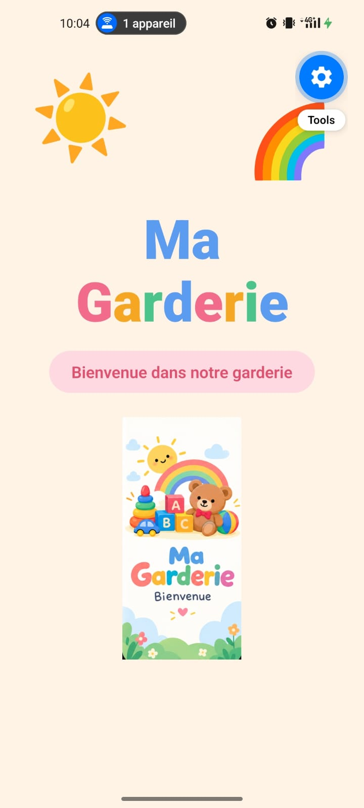
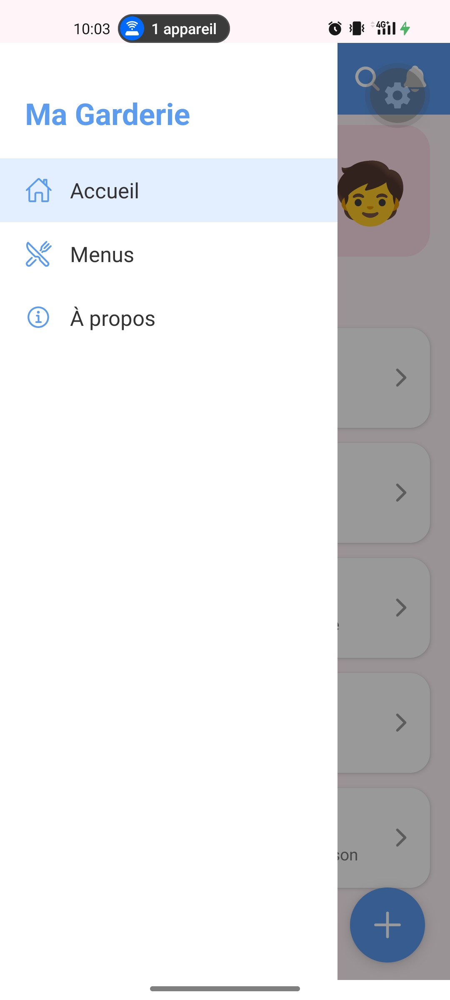

# Ma Garderie

Application mobile de gestion des menus d'une garderie d'enfants. Elle comprend un écran de démarrage, une page principale avec AppBar, Drawer et bouton flottant, la liste des menus du jour et des interactions (messages, sélection).

## Technologies utilisées
- React Native (Expo)
- JavaScript
- Git et GitHub

## Installation et exécution
```bash
git clone https://github.com/TON_PSEUDO/garderie-mobile-g2.git
cd garderie-mobile-g2
npm install
npx expo start
```
Scanner le QR code avec l'application Expo Go, ou appuyer sur `a` pour lancer l'émulateur Android.

## Captures d'écran
| Splash Screen | Page principale |
|---|---|
|  |  |

| Drawer ouvert | Message après interaction |
|---|---|
|  |  |